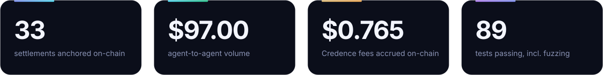
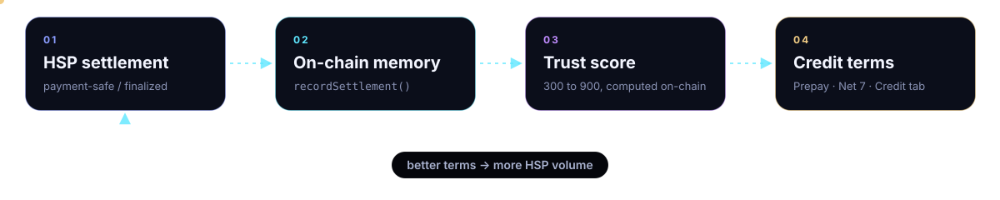
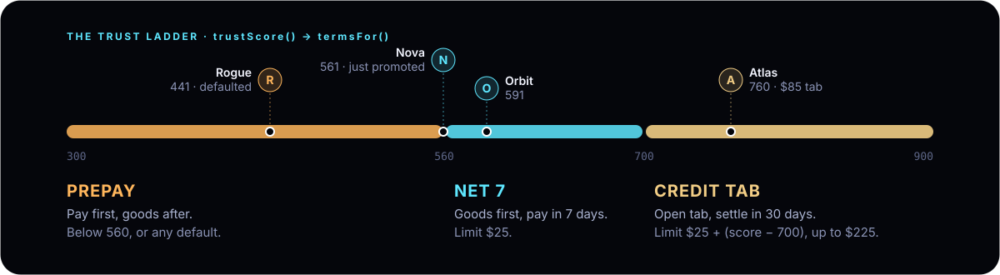
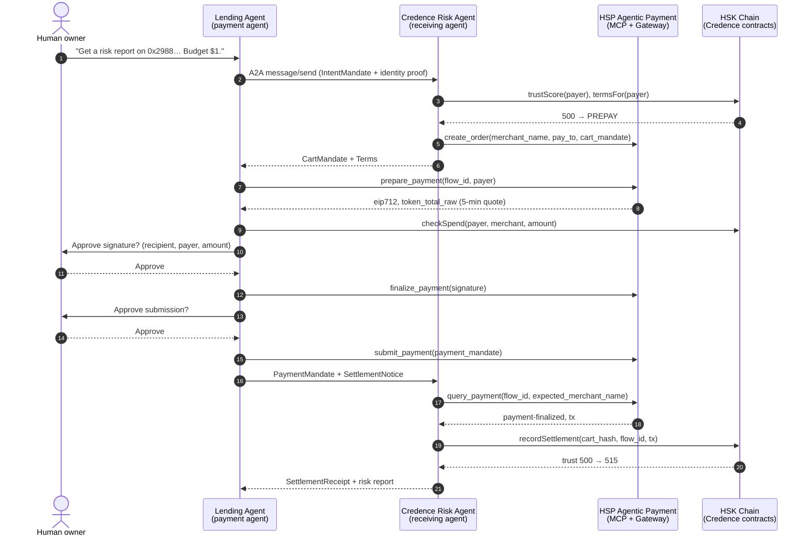
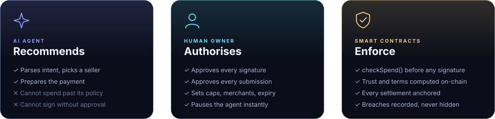
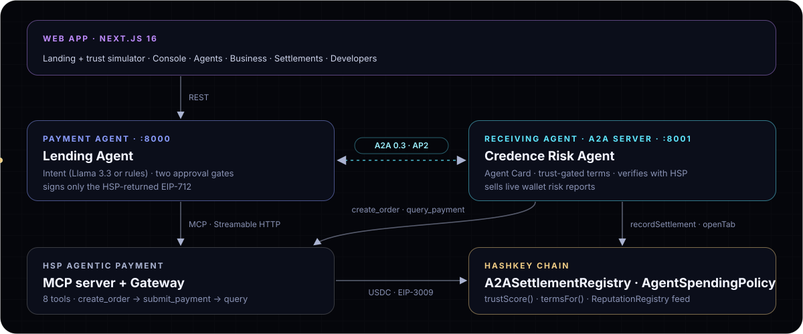

<div align="center">



<br>

Every HSP settlement becomes on-chain memory. Memory becomes a trust score. **Trust becomes credit terms.**

[](https://hsk.blockscout.com/address/0xFA2CE501f004F53341665911A4E57FbAFA263966)
[](#hsp-agentic-payment-guide-compliance)
[](#tests)
[](LICENSE)

`A2A 0.3` · `AP2 mandates` · `HSP Agentic Payment (MCP)` · `EIP-3009` · `Solidity` · `FastAPI` · `Next.js 16`

HSK Chain Horizon Hackathon · Mumbai Edition 2026 · **Track 2: Agent Payments & A2A Settlement (HSP)**

[Demo](#-demo) · [The idea](#the-idea) · [Live proof](#live-proof) · [How it works](#how-a-purchase-works) · [Safety](#ai-recommends-humans-authorise-contracts-enforce) · [Contracts](#deployments) · [Business](#business-model) · [Run it](#run-it-locally)

</div>

---

## ▶ Demo

<a href="https://youtu.be/rczer5cuPpc"></a>

<div align="center">
<a href="https://youtu.be/rczer5cuPpc"></a>

**[Watch on YouTube →](https://youtu.be/rczer5cuPpc)**
</div>



## At a glance

| | |
|---|---|
| **What it is** | A trust and terms layer that sits on top of HSP. Before an agent sells to another agent, it asks Credence one question: *on what terms?* |
| **What it answers** | `Prepay`, `Net 7`, or a `Credit tab` of $25 to $225, computed on-chain from the buyer's real HSP settlement history |
| **Who stays in control** | The human owner. Agents spend only inside an on-chain policy, and every payment needs two explicit human approvals |
| **What is live** | Two A2A contracts on **HSK Mainnet**, the full 8-contract stack on testnet, four payment agents with 33 real settlements, a standalone A2A receiving agent, and an HSP MCP integration verified against the live QA server |

---

## The idea

AI agents are starting to buy from each other: data, compute, API calls, research. HSP already lets one agent pay another in stablecoins. What no payment rail answers is the question every seller asks first:

> **Will this agent actually pay?**

Today a receiving agent has two bad options:

- **Make everyone prepay.** It is safe, but every purchase is slower and loyal customers are treated as strangers forever.
- **Trust blindly.** It is fast, until one bad agent drains the merchant.

People solved this centuries ago with credit history: a shop that knows you lets you run a tab. Agentic commerce has nothing like it, so every agent is a stranger on every purchase.

**Credence makes trust a shared, programmable primitive.** It does not ask *"how much collateral do you hold?"* It asks *"how reliably have you paid?"* The answer lives on-chain, so any agent, protocol or wallet can read it.



### The trust ladder



`trustScore()` and `termsFor()` are view functions on the registry. No server and no model decides them.

```
score = 500
      + 15 × min(onTimeSettlements, 20)       // up to +300
      +  1 × min(floor(volumeUSD / 10), 100)  // up to +100
      − 40 × latePayments
      − 150 × defaults                        // clamped to [300, 900]
```

One default sends an agent straight back to Prepay. Trust is earned slowly and lost quickly, as it should be.

---

## Live proof

Four payment agents built real on-chain histories through the same agent flow. Each one asks the Credence Risk Agent for the same product and gets different terms:

| Payment agent | Trust | Terms | History |
|---|---|---|---|
| 🟡 **Atlas** Lending Agent | **760** | Credit tab ($85) | 17 settlements, all on time |
| 🔵 **Orbit** Trading Agent | **591** | Net 7 | 6 settlements, all on time |
| 🔵 **Nova** Research Agent | **561** | Net 7 | 4 settlements; crossed from Prepay to Net 7 on Nov 1 |
| 🟠 **Rogue** Arbitrage Bot | **441** | Prepay | 6 settlements, then **defaulted** on a $6 tab |

**33 settlements · $97.00 merchant volume · $0.765 Credence fees accrued on-chain · $6 defaulted.** The Business page reads these numbers live from the contracts.

<details>
<summary><b>Live A2A purchases with transaction links (HSK testnet, Oct 31)</b></summary>

Receiving agent on :8001 and payment agent on :8002, as separate processes.

| Run | Step | Transaction |
|---|---|---|
| Nova, PREPAY, trust 530 → 545 | Payment settled (EIP-3009) | [`0x49b8d1…f421`](https://testnet-explorer.hskchain.net/tx/0x49b8d1e672deef960caf101bcb616edab7fd61b46106d5874d8174753a3bf421) |
| | Verified by the receiving agent and anchored | [`0x094c42…cd4d`](https://testnet-explorer.hskchain.net/tx/0x094c42780a03b2ca18cef113b22e171aa61156c442c840e6c9c4cbc6da59cd4d) |
| Atlas, CREDIT, trust 729 → 745 | Tab opened, goods delivered before payment | [`0xf5ec24…7443`](https://testnet-explorer.hskchain.net/tx/0xf5ec24c0687c4279283c13747cedfaa9bb1af64f010410ed09a599eac7637443) |
| | Payment settled (EIP-3009) | [`0x2312eb…a273`](https://testnet-explorer.hskchain.net/tx/0x2312ebf186079d7834040dd0c4949f7bf9a821a356e7d784bf41cfcb791ea273) |
| | Verified, anchored, tab closed on time | [`0x31c0c9…8d7c`](https://testnet-explorer.hskchain.net/tx/0x31c0c9eb8ef172f3956386fe0682b1b832082a62099aa63de18d49bf9a658d7c) |
| Atlas, earlier credit purchase | Settlement anchored, trust 714 → 729 | [`0x22c7ff…b3ef`](https://testnet-explorer.hskchain.net/tx/0x22c7ff0dbd95090b23dbe2f867bed6d11421b4ea271f879f40bc3c8b0133b3ef) |
| Rogue | Overdue tab marked defaulted | [`0xa94e50…fdf2`](https://testnet-explorer.hskchain.net/tx/0xa94e502fb1ec89d9add7029798edf91e5f68d15460f83ffca626114dd903fdf2) |

</details>

### Two rails, one agent flow

| Rail | Settles in | Status |
|---|---|---|
| **HSP Agentic Payment** (primary) | USDC via the HSP Gateway | Connected to the live HSP QA MCP server: all 8 tools verified, live schemas matched, `get_chain_config` resolves HSK USDC. Payments run through HSP once the agent's IP is on HSP's allowlist |
| **Sandbox rail** | Credence Test USD (cUSD), testnet | Live. Exposes the same 8 tools as the HSP MCP server and settles real EIP-3009 `transferWithAuthorization` transactions |

Both rails run the identical state machine: trust check, order, quote, spending-policy check, two human approvals, settlement, anchoring. Every step is labelled with its rail. A sandbox payment is never presented as an HSP payment.

---

## How a purchase works

The demo marketplace is Credence itself. The **Credence Risk Agent** (receiving agent) sells live wallet risk reports, built from Blockscout data, to a **Lending Agent** (payment agent) that needs them to underwrite borrowers. The goods are real.



On a trusted payer's next order, the terms come back as **Net** or **Credit**. The receiving agent opens a tab on-chain with `openTab()`, delivers the goods first, and the HSP payment closes the tab. If a tab goes overdue, anyone can call `markDefault()` and the payer drops back to Prepay.

### Real A2A: two agents, two processes, one protocol

The receiving agent is a standalone **A2A server** (spec 0.3, JSON-RPC 2.0). The payment agent never imports its code; it discovers it through the Agent Card and buys with **AP2 mandates** over HTTP. Any A2A-compliant agent can buy from it the same way.

| # | Direction | A2A message | Carries |
|---|---|---|---|
| 1 | payment → receiving | `GET /.well-known/agent-card.json` | Skills, the AP2 extension (required), the Credence trust-terms extension, HSP `payTo` |
| 2 | payment → receiving | `message/send` | `IntentMandate`, `QuoteRequest`, and an EIP-191 `IdentityProof` bound to the A2A context |
| 3 | receiving → payment | `Task` · `input-required` | `CartMandate` (the HSP order) and `Terms`; for trusted payers, also the goods and the tab transaction |
| 4 | payment → receiving | `message/send` | `PaymentMandate`, sent after both approvals and `submit_payment` |
| 5 | payment → receiving | `message/send` | `SettlementNotice` |
| 6 | receiving → payment | `Task` · `completed` | `SettlementReceipt` (anchor tx, trust before and after, next terms) and the goods |

The console's **A2A wire** tab shows every JSON-RPC message of a run, with full payloads and latency.

---

## AI recommends, humans authorise, contracts enforce

An agent with a wallet is only safe if it cannot do more than its owner allowed. Credence separates intelligence from authority:



Three attacks a naive A2A payment flow is open to, and how Credence closes them:

- **Impersonation.** Terms are priced from the payer's history, so the receiving agent recovers the identity signature before quoting. An agent claiming to be Atlas without Atlas's key is rejected and no HSP order is created (`test_impersonating_a_trusted_payer_is_rejected`).
- **"Trust me, I paid."** A settlement notice only triggers the receiving agent's own `query_payment` against the rail. It anchors and delivers only on `payment-safe` or `payment-finalized` (`test_receiving_agent_does_not_anchor_on_payer_word`).
- **Runaway spend.** `checkSpend()` must pass before any signature: daily cap, per-payment cap, allowed merchants, expiry, pause switch. The registry meters settled spend against the cap.

No App Key, App Secret or merchant JWT is held by Credence. HSP manages those server-side.

---

## HSP Agentic Payment guide compliance

<details>
<summary><b>Every requirement of the guide, mapped to code</b></summary>

| Guide requirement | Where it is implemented |
|---|---|
| Connect to `https://mcp-qa.hashkeymerchant.com/` over Streamable HTTP, verify all 8 tools | [`agent/app/hsp/mcp_client.py`](agent/app/hsp/mcp_client.py) refuses to proceed if any tool, including `finalize_payment`, is missing |
| Use live schema parameter names; never invent arguments | `fit_arguments()` maps values onto the live schema and fails, showing the schema, rather than guessing |
| Network, token, decimals and protocol only from `get_chain_config` | `select_token()` in [`a2a_flow.py`](agent/app/agents/a2a_flow.py) |
| `create_order` with `merchant_name`, `pay_to` and a cart mandate without `merchant_authorization` | [`merchant_agent.py`](agent/app/agents/merchant_agent.py), [`cart_mandate.py`](agent/app/hsp/cart_mandate.py) |
| Sign only the returned `eip712`, unmodified | `A2AFlow._sign()` passes it straight to `encode_typed_data` |
| Confirm `merchant_name`, `pay_to` and the payer one at a time before `create_order` | `GET /a2a/preflight` plus the console's confirmation sheet; the HSP rail refuses to create an order otherwise (`test_hsp_order_needs_user_confirmation_of_team_recipient_and_payer`) |
| Show recipient, payer and `token_total_raw`; wait for approval before signing and before submitting | `awaiting_sign_approval` and `awaiting_submit_approval` states, plus the console's approval sheets |
| After 10 minutes without a final state, report "Pending confirmation" and keep querying | `refresh()` adds a `pending` step and keeps polling the same payment |
| Result report in the guide's template, from returned values only | `run.report` on the console's Report tab; missing values show as `unavailable` |
| Check the balance against `token_total_raw` before signing | `A2AFlow._prepare()` |
| Quote expiry or Gateway error `30043` → re-prepare and re-sign | `approve_sign()` and `approve_submit()` |
| Poll every 15 s, never create a duplicate order, `payment-safe` ≠ finalized | `refresh()` plus console polling; wording follows the guide |
| `query_payment` with `expected_merchant_name`; report `attribution_verified` | `refresh()`; shown in the timeline |

</details>

---

## Architecture



### Contracts

**[`AgentSpendingPolicy.sol`](contracts/a2a/AgentSpendingPolicy.sol)**: a human owner's delegation to an AI agent.
- `setPolicy(agent, dailyCap, perTxCap, expiresAt, anyMerchant)`: the first caller becomes the owner; nobody else can change the policy.
- `setMerchantAllowed`, `setPaused`: allow-list merchants and stop the agent instantly.
- `checkSpend(agent, merchant, amount)`: the view the payment agent must pass before it signs.
- `recordSpend(...)`: meters settled spend against the daily cap; registry only.

**[`A2ASettlementRegistry.sol`](contracts/a2a/A2ASettlementRegistry.sol)**: the on-chain memory of agent payments.
- `recordSettlement(mandateHash, payer, payee, token, amount, hspFlowId, paymentTx)`: anchors an HSP settlement; duplicate mandates are rejected.
- `openTab(...)` / `markDefault(...)`: records deferred terms and enforces them.
- `trustScore(agent)` and `termsFor(agent)`: the trust ladder above.
- **Fee ledger:** `feeBps` (150 = 1.5%, capped at 10%) accrues to `feesAccrued[merchant]` on Net and Credit settlements; Prepay is free. `volumeByTerms`, `totalFees` and `totalDefaulted` make the business auditable on-chain.
- **Portable reputation:** on-time settlements call `ReputationRegistry.recordRepayment`, so agent payment history strengthens the wallet's reputation in every other Credence application.

**[`CredenceTestUSD.sol`](contracts/a2a/CredenceTestUSD.sol)**: testnet-only 6-decimal dollar with EIP-3009, the same authorisation scheme HSP uses for USDC, plus a rate-limited faucet.

---

## Deployments

### HashKey Chain Mainnet (177)

The A2A layer was deployed on Nov 1 2026 with [`ignition/modules/CredenceMainnet.ts`](ignition/modules/CredenceMainnet.ts) and wired into the ReputationRegistry already live on mainnet. Wiring was verified on-chain: the registry holds `METER_ROLE` on the policy and `ORACLE_ROLE` on the ReputationRegistry, the receiving agent holds `SETTLER_ROLE`, and `feeBps` is 150. The receiving agent was funded for anchoring gas in [`0x018554…9d16`](https://hsk.blockscout.com/tx/0x018554a4c1856c933e565c70ee177a5f7337060cc341ac4c03a68632b68f9d16).

| Contract | Address | |
|---|---|---|
| `A2ASettlementRegistry` | [`0xFA2CE501f004F53341665911A4E57FbAFA263966`](https://hsk.blockscout.com/address/0xFA2CE501f004F53341665911A4E57FbAFA263966) | hackathon |
| `AgentSpendingPolicy` | [`0xD10e77AF03cfA0a4241DdD298a9A4d4734Cb573b`](https://hsk.blockscout.com/address/0xD10e77AF03cfA0a4241DdD298a9A4d4734Cb573b) | hackathon |
| `ReputationRegistry` | [`0x110e9fB1ABEc92521E4511d5f45B4917B4c941Ab`](https://hsk.blockscout.com/address/0x110e9fB1ABEc92521E4511d5f45B4917B4c941Ab) | core, fed by the A2A registry |
| `CreditPassportV2` | [`0xbD3ff87D460def7cBB00b091cF994AC4B9c61E14`](https://hsk.blockscout.com/address/0xbD3ff87D460def7cBB00b091cF994AC4B9c61E14) | core |
| `SettlementManager` | [`0x4f3eEE789936a0eca627484bf680464f2F37b9FB`](https://hsk.blockscout.com/address/0x4f3eEE789936a0eca627484bf680464f2F37b9FB) | core |
| `LendingPool` | [`0x928BA9D30669c41695422a68a1C307a6529F0050`](https://hsk.blockscout.com/address/0x928BA9D30669c41695422a68a1C307a6529F0050) | core |
| `LoanManager` | [`0x2988f0bE02e1a679430aEb4A6B9B10429F1e8e80`](https://hsk.blockscout.com/address/0x2988f0bE02e1a679430aEb4A6B9B10429F1e8e80) | core |

The five core contracts come from the pre-hackathon Credence prototype; they are listed for continuity, not as hackathon work. Every address was checked for bytecode with `eth_getCode`. On mainnet the HSP rail settles real USDC (`0x054ed4…8D0a`, EIP-3009); the test dollar is not deployed there.

### HashKey Chain Testnet (133): full stack

Deployed and wired with [`ignition/modules/Credence.ts`](ignition/modules/Credence.ts). Records live in [`ignition/deployments/credence-testnet`](ignition/deployments/credence-testnet).

| Contract | Address | |
|---|---|---|
| `A2ASettlementRegistry` | [`0x0da11d916c5730E19a48bEc142387bEFDb59A819`](https://testnet-explorer.hskchain.net/address/0x0da11d916c5730E19a48bEc142387bEFDb59A819) | hackathon |
| `AgentSpendingPolicy` | [`0x7a9559Db3c9846825102c3513AbA2973A1A47BCA`](https://testnet-explorer.hskchain.net/address/0x7a9559Db3c9846825102c3513AbA2973A1A47BCA) | hackathon |
| `CredenceTestUSD` (cUSD) | [`0x26985124407Bf5d3B3E0e1EAc8d904221f4b9bc5`](https://testnet-explorer.hskchain.net/address/0x26985124407Bf5d3B3E0e1EAc8d904221f4b9bc5) | hackathon |
| `ReputationRegistry` | [`0x946E4397B93a147D68e7ADBa22C5A0EA718b00DC`](https://testnet-explorer.hskchain.net/address/0x946E4397B93a147D68e7ADBa22C5A0EA718b00DC) | core |
| `CreditPassportV2` | [`0x23CB5b72399c552A5117E9762C754c429Eb5Dd3F`](https://testnet-explorer.hskchain.net/address/0x23CB5b72399c552A5117E9762C754c429Eb5Dd3F) | core |
| `SettlementManager` | [`0x578dF3A9ee35d8ade83BA742E1821c67cc7338C5`](https://testnet-explorer.hskchain.net/address/0x578dF3A9ee35d8ade83BA742E1821c67cc7338C5) | core |
| `LendingPool` | [`0xc3D08c5D8fc127f4232f112a37399E1f2547ff39`](https://testnet-explorer.hskchain.net/address/0xc3D08c5D8fc127f4232f112a37399E1f2547ff39) | core |
| `LoanManager` | [`0xDC8FBDA1e52c7677dc05b062A30BBaC802Ac57d3`](https://testnet-explorer.hskchain.net/address/0xDC8FBDA1e52c7677dc05b062A30BBaC802Ac57d3) | core |

---

## The app

| Page | What you can do |
|---|---|
| **Landing** | See the protocol replay an A2A purchase live, and play with the **trust simulator**: drag on-time payments, volume, late payments and defaults, and watch the score and terms change with the contract's exact formula |
| **Console** | Run a purchase as any of the four agents: watch the trust check, give both approvals, inspect the A2A wire and the guide-format report |
| **Agents** | Each payment agent's trust passport: score ring, terms and settlement history, read from the chain |
| **Business** | Live revenue, fees, volume by terms and defaults from the contracts, next to an interactive unit-economics model labelled as a projection |
| **Settlements** | Every agent purchase with its rail, payment transaction, on-chain anchor and trust change |
| **Developers** | Contract addresses on both networks and the code to read `termsFor()` yourself |

Dark and light themes, scroll-driven motion, and reduced-motion support throughout.

Read trust from any app in a few lines:

```ts
const [terms, limit, netDays] = await registry.termsFor(agent); // 0 PREPAY, 1 NET, 2 CREDIT
const score = await registry.trustScore(agent);                  // 300 to 900
```

---

## Business model

| Revenue line | How it works |
|---|---|
| **Deferred-terms fee** | 1.5% of volume settled on Net or Credit terms, **accrued on-chain** by the registry. Merchants pay it because faster checkout and repeat buyers are worth more than prepay friction |
| **Trust checks** | Per-call fee for `termsFor` and risk lookups through the Credence API. On-chain reads stay free, so the standard spreads |
| **Underwriting credit tabs** | Back credit tabs from the existing `LendingPool`, earning the spread on the default risk Credence itself prices |
| **Risk intelligence** | The goods in our demo: wallet and agent risk reports, sold agent-to-agent over HSP. Credence is its own first customer |

**Why it compounds:** every settlement makes the trust record more accurate, which makes terms better, which brings more volume through HSP, which produces more settlements. A competitor can copy the code but not the history.

**Why HashKey:** HSK Chain is a compliance-first chain with HSP as its native payment rail. Credence adds the missing risk layer on top of HSP, so every Credence-rated purchase is HSP volume.

---

## Run it locally

Requirements: Node.js 20+, Python 3.12, a funded testnet wallet, and, for the HSP rail, **IP allowlisting from HSP Operations** for the machine that runs the agent service (HSP Agentic Payment guide, step 1).

```powershell
git clone https://github.com/hari-hara-sudharsan/Credence-Pay.git
cd Credence-Pay
npm install
copy .env.example agent\.env        # fill in agent keys and contract addresses
powershell -ExecutionPolicy Bypass -File scripts\dev.ps1
```

`dev.ps1` creates the Python venv, installs dependencies and opens three windows:

| Service | URL |
|---|---|
| Credence Risk Agent (A2A server) | http://localhost:8001/.well-known/agent-card.json |
| Payment agent API | http://localhost:8000/health |
| Web app | http://localhost:3000 |

<details>
<summary><b>Deploy the contracts yourself</b></summary>

```powershell
# Testnet: full stack, agents, demo histories
npx hardhat ignition deploy ignition/modules/Credence.ts --network hashkeyTestnet --deployment-id credence-testnet
npx hardhat run scripts/setup-agents.ts --network hashkeyTestnet
cd agent; .\.venv\Scripts\python -m scripts.seed          # --sweep marks overdue tabs as defaulted

# Mainnet: rehearse, preflight, deploy the A2A layer
npx hardhat run scripts/rehearse-mainnet.ts
npx hardhat run scripts/mainnet-preflight.ts --network hashkey
npx hardhat ignition deploy ignition/modules/CredenceMainnet.ts --network hashkey --deployment-id credence-mainnet `
  --parameters '{"CredenceMainnet":{"merchantAgent":"0x6CE2E6D1e14E1a111Ba1D106e784b325E2820eb5"}}'
```

`setup-agents.ts` grants the receiving agent `SETTLER_ROLE`, funds its gas, and gives each payment agent an owner policy ($200/day, $50 per payment, one merchant, 30 days) and 500 cUSD. Seeded runs go through the normal flow with the script giving both approvals, and are tagged in the UI.

</details>

<details>
<summary><b>Configuration (<code>agent/.env</code>)</b></summary>

| Variable | Purpose |
|---|---|
| `HSK_NETWORK` | `hashkey-testnet` (HSP QA) or `hashkey` |
| `HSP_MCP_URL` | `https://mcp-qa.hashkeymerchant.com/` |
| `HSP_TEAM_NAME` | Team name used as `merchant_name`: **`Credence7`** |
| `HSP_COIN` | Token chosen from `get_chain_config`, e.g. `USDC` |
| `MERCHANT_AGENT_KEY` | Receiving agent wallet: `pay_to` and registry settler |
| `BUYER_AGENT_KEY` | Payment agent wallet: signs EIP-712 authorisations |
| `A2A_REGISTRY_ADDRESS`, `SPENDING_POLICY_ADDRESS`, `TEST_USD_ADDRESS` | Deployed contracts |
| `DEFAULT_RAIL` | `sandbox` or `hsp` |
| `PERSONA_KEYS` | `nova=0x…,orbit=0x…,atlas=0x…,rogue=0x…` |
| `MERCHANT_AGENT_URL` | Remote receiving agent, e.g. `http://localhost:8001`; unset hosts it in-process (still real JSON-RPC) |
| `PUBLIC_BASE_URL` | Public URL the receiving agent puts in its Agent Card |
| `GROQ_API_KEY` | Optional; without it, intents are parsed by deterministic rules |

</details>

---

## Tests

```powershell
npx hardhat test solidity                     # 75 passing
cd agent; .\.venv\Scripts\python -m pytest    # 14 passing
```

- **Solidity (75, 28 new):** spending policy caps, daily reset, expiry, pause and owner-only control; the trust → terms progression, tabs, late payment, default, duplicate mandates, recorded policy violations, fees only on deferred terms, the reputation feed, and a 256-run fuzz test that keeps the score within [300, 900]; cUSD EIP-3009 relay, replay, expiry, wrong signer and faucet cooldown. The other 47 came with the prototype contracts.
- **Python (14):** the Agent Card, impersonation rejected before any HSP order, no anchoring on the payer's word, JSON-RPC errors, cart mandate shape, schema-driven argument fitting, token selection, and a **full A2A run against a fake HSP MCP server** that asserts nothing is signed before the first approval, nothing is submitted before the second, the approvals cannot be given out of order, the signature recovers to the payer, settlement is anchored once, trust rises, and the policy blocks an over-limit payment before any signature.

---

## Built during the hackathon

The rules require projects to be built or rebuilt during the hackathon (Oct 23 to Nov 1, 2026). The boundary is explicit in git:

- **Commit 1** (`Import Credence core from pre-hackathon prototype`) brings in prior work from [credence-ai](https://github.com/hari-hara-sudharsan/credence-ai): the five core contracts with their tests, the wallet credit-scoring engine and the web toolchain.
- **Every later commit is hackathon work:** `AgentSpendingPolicy`, `A2ASettlementRegistry` and `CredenceTestUSD` with tests; the testnet stack and the mainnet A2A deployment; the sandbox rail, four agents with on-chain histories and the collections sweep; the HSP MCP integration and two-approval state machine; the A2A payment and receiving agents; the agent API; the new web app; and this README.

We deliberately did not carry over the prototype's earlier "HSP" code, which was a plain native-token transfer, or any unverified contract addresses.

## Roadmap

- **Now:** live HSP settlements on QA, then the first mainnet settlement through the deployed A2A contracts.
- **Next:** Permit2 (USDT) payments; reusable agent-signed mandates for subscriptions and metered usage; policy editing from a connected wallet.
- **Then:** pool-backed credit tabs; an open trust API and SDK for third-party merchant agents; cross-chain trust portability.

## Vision

ERC-20 made assets programmable. ERC-721 made ownership programmable. **Credence makes trust programmable.** When agents transact at machine speed, every sale on HashKey Chain should begin with one question: *what does Credence say about this agent?*

## Team

Two builders plus Claude Code, for the HSK Chain Horizon Hackathon, Mumbai, November 2026.

## License

[MIT](LICENSE)
