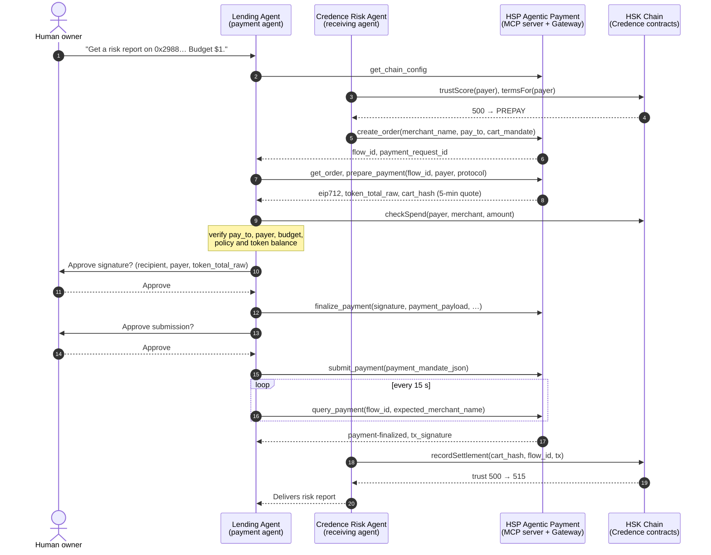

<div align="center">

# Credence

### HSP lets agents pay each other. Credence decides on what terms.

**Trust-gated agent-to-agent payments on HSK Chain, settled through HSP Agentic Payment.**

HSK Chain Horizon Hackathon · Mumbai Edition · Track 2: **Agent Payments & A2A Settlement (HSP)**

[Agent Console](#run-it-locally) · [How it works](#how-a-purchase-works) · [Contracts](#deployments) · [Business model](#business-model) · [What we built during the hackathon](#built-during-the-hackathon)

</div>

---

## The problem

AI agents are starting to buy from each other: data, compute, API calls, research. Payment rails such as HSP already let an agent pay another agent in stablecoins. What no rail answers is the question every merchant asks first:

> **Will this agent actually pay?**

Today a receiving agent has two bad options:

- **Make everyone prepay.** This is safe, but every purchase is slower, and good customers are treated like strangers forever.
- **Trust blindly.** This is fast, but one bad agent drains the merchant.

Human commerce solved this with credit history. A shop that knows you lets you run a tab. Agentic commerce has no equivalent, so every agent is a stranger on every purchase.

## The solution

Credence is a **trust and terms layer for agent payments**, built on HSP and HSK Chain.

1. **Every HSP settlement becomes on-chain memory.** When a payment reaches `payment-safe` or `payment-finalized`, Credence records the mandate on-chain with its HSP flow ID and transaction hash.
2. **Memory becomes a trust score.** `trustScore()` is computed on-chain from settlement history: on-time payments, volume, late payments, and defaults.
3. **Trust becomes terms.** `termsFor()` tells any receiving agent what to offer:

| Trust score | Terms | What the merchant agent does |
|---|---|---|
| < 560, or any default | **Prepay** | Payment settles before goods are delivered |
| 560 – 699 | **Net 7** | Goods delivered first, payment due within 7 days |
| ≥ 700 | **Credit tab** | Open tab of 25 to 225 USD, due within 30 days |

4. **Humans stay in control.** An agent can only spend inside an on-chain policy set by its human owner: daily cap, per-payment cap, allowed merchants, expiry, and a pause switch. Every payment also requires **two explicit human approvals**, once before signing and once before submission, as the HSP Agentic Payment guide requires.

The demo marketplace is Credence itself. The **Credence Risk Agent** (receiving agent) sells wallet risk reports to a **Lending Agent** (payment agent) that needs them to underwrite borrowers. The goods are real: live credit analysis of HSK Chain wallets from Blockscout data.

### Live on HSK testnet right now

Four payment agents have real on-chain payment histories, built through the same agent flow. Each one asks for the same product and is offered different terms:

| Payment agent | Trust | Terms | On-chain history |
|---|---|---|---|
| Atlas Lending Agent | **760** | Credit tab | 17 settlements, all on time |
| Orbit Trading Agent | **591** | Net 7 | 6 settlements, all on time |
| Nova Research Agent | **561** | Net 7 | 4 settlements; crossed from Prepay to Net 7 on Nov 1 |
| Rogue Arbitrage Bot | **441** | Prepay | 6 settlements, then **defaulted** on a $6 tab |

The registry holds **33 settlements, $97.00 of merchant volume, $0.765 of Credence fees accrued on-chain, and $6 defaulted** (as of Nov 1). The Business page reads these numbers live from the contracts.

### Two payment rails, one agent flow

| Rail | Settles in | Status |
|---|---|---|
| **HSP Agentic Payment** (primary) | USDC (`0x8FE3…53c6`, eip3009) via the HSP Gateway | Connected to the live HSP QA MCP server on Oct 31: all 8 tools verified, live schemas match, `get_chain_config` resolves HSK testnet USDC. First live payment is waiting on test USDC in a payer wallet, which the team funds manually as the guide requires |
| **Sandbox rail** | Credence Test USD (cUSD) on HSK testnet | Live. It exposes the same 8 tools as the HSP MCP server and settles real EIP-3009 `transferWithAuthorization` transactions |

Both rails run the identical state machine: trust check, order, quote, spending-policy check, two human approvals, settlement, anchoring. Every step and every settlement is labelled with the rail it used. A sandbox payment is never presented as an HSP payment.

### Real A2A: two agents, two processes, one protocol

The receiving agent is a standalone **A2A server** (A2A spec 0.3, JSON-RPC 2.0). The payment agent never calls its code. It finds the agent through its Agent Card and buys from it with **AP2 payment mandates** over HTTP. Any A2A-compliant agent can buy from the Credence Risk Agent the same way.

| # | Direction | A2A message | What it carries |
|---|---|---|---|
| 1 | payment → receiving | `GET /.well-known/agent-card.json` | Skills, the AP2 extension (required), the Credence trust-terms extension, HSP `payTo` |
| 2 | payment → receiving | `message/send` | `ap2.mandates.IntentMandate`, `credence.QuoteRequest`, and `credence.IdentityProof` (an EIP-191 signature from the payer's wallet, bound to the A2A context) |
| 3 | receiving → payment | `Task` · `input-required` | `ap2.mandates.CartMandate` (HSP order created by the receiving agent) and `credence.Terms`. For trusted payers it also carries the goods and the on-chain tab transaction |
| 4 | payment → receiving | `message/send` | `ap2.mandates.PaymentMandate`, sent after both human approvals and HSP `submit_payment` |
| 5 | payment → receiving | `message/send` | `credence.SettlementNotice` |
| 6 | receiving → payment | `Task` · `completed` | `credence.SettlementReceipt` (anchor transaction, trust before/after, next terms) and the goods |

Two properties a naive A2A payment flow lacks:

- **No impersonation.** Terms are priced from the payer's on-chain history, so the receiving agent recovers the identity signature before quoting. An agent that claims to be Atlas without Atlas's key is `rejected`, and no HSP order is created (`test_impersonating_a_trusted_payer_is_rejected`).
- **The payer's word is not enough.** A settlement notice only triggers the receiving agent's own `query_payment` against the rail, with `expected_merchant_name`. It anchors and delivers only on `payment-safe` or `payment-finalized` (`test_receiving_agent_does_not_anchor_on_payer_word`).

The console's **A2A wire** tab shows every JSON-RPC message of a run, with full payloads and latency.

**Live A2A purchases, HSK testnet, Oct 31 2026** (Risk Agent on :8001, payment agent API on :8002, separate processes):

| Run | Step | Transaction |
|---|---|---|
| Nova, PREPAY, trust 530 → 545 | Payment settled (EIP-3009) | [`0x49b8d1…f421`](https://testnet-explorer.hskchain.net/tx/0x49b8d1e672deef960caf101bcb616edab7fd61b46106d5874d8174753a3bf421) |
| | Verified by the receiving agent and anchored | [`0x094c42…cd4d`](https://testnet-explorer.hskchain.net/tx/0x094c42780a03b2ca18cef113b22e171aa61156c442c840e6c9c4cbc6da59cd4d) |
| Atlas, CREDIT, trust 729 → 745 | Tab opened, goods delivered before payment | [`0xf5ec24…7443`](https://testnet-explorer.hskchain.net/tx/0xf5ec24c0687c4279283c13747cedfaa9bb1af64f010410ed09a599eac7637443) |
| | Payment settled (EIP-3009) | [`0x2312eb…a273`](https://testnet-explorer.hskchain.net/tx/0x2312ebf186079d7834040dd0c4949f7bf9a821a356e7d784bf41cfcb791ea273) |
| | Verified, anchored, tab closed on time | [`0x31c0c9…8d7c`](https://testnet-explorer.hskchain.net/tx/0x31c0c9eb8ef172f3956386fe0682b1b832082a62099aa63de18d49bf9a658d7c) |

---

## How a purchase works



On a trusted payer's next order, step 3 returns **Net** or **Credit**. The merchant opens a tab on-chain with `openTab()`, delivers the goods first, and the HSP payment closes the tab. If the tab goes overdue, anyone can call `markDefault()`, and the payer drops back to prepay.

### Mapping to the HSP Agentic Payment guide

| Guide requirement | Where it is implemented |
|---|---|
| Connect to `https://mcp-qa.hashkeymerchant.com/` over Streamable HTTP, verify all 8 tools | [`agent/app/hsp/mcp_client.py`](agent/app/hsp/mcp_client.py) refuses to proceed if any tool, including `finalize_payment`, is missing |
| Use live schema parameter names; do not invent arguments | `fit_arguments()` maps values onto the live schema and fails, showing the schema, rather than guessing |
| Network, token, decimals and protocol only from `get_chain_config` | `select_token()` in [`a2a_flow.py`](agent/app/agents/a2a_flow.py) |
| `create_order` with `merchant_name`, `pay_to` and a cart mandate without `merchant_authorization` | [`merchant_agent.py`](agent/app/agents/merchant_agent.py), [`cart_mandate.py`](agent/app/hsp/cart_mandate.py) |
| Sign only the returned `eip712`, unmodified | `A2AFlow._sign()` passes it straight to `encode_typed_data` |
| Confirm `merchant_name`, then `pay_to`, then the payer, one at a time, before `create_order` | `GET /a2a/preflight` plus the console's confirmation sheet. On the HSP rail the flow refuses to create an order unless all three were confirmed exactly (`test_hsp_order_needs_user_confirmation_of_team_recipient_and_payer`) |
| Show recipient, payer and `token_total_raw`; wait for approval before signing and before submitting | `awaiting_sign_approval` and `awaiting_submit_approval` states, plus the approval sheets in the console |
| After 10 minutes without a final state, report "Pending confirmation" with both identifiers and keep querying | `refresh()` adds a `pending` step and keeps polling the same payment |
| Result report in the guide's template, from returned values only | `run.report`, shown on the console's Report tab; missing values are shown as `unavailable` |
| Check the balance against `token_total_raw` before signing | `A2AFlow._prepare()` |
| Quote expiry or Gateway error `30043` → re-prepare and re-sign | `approve_sign()` and `approve_submit()` |
| Poll every 15 s, never create a duplicate order, `payment-safe` ≠ finalized | `refresh()` plus console polling; status wording follows the guide |
| `query_payment` with `expected_merchant_name`; report `attribution_verified` | `refresh()`; shown in the timeline |

No App Key, App Secret or merchant JWT is held by Credence. HSP manages those server-side.

---

## Architecture

```
┌───────────────────────────── web/ (Next.js 16) ─────────────────────────────┐
│  Landing · Console · Agents · Business · Settlements · Developers · Passport  │
└──────────────────────────────────────┬──────────────────────────────────────┘
                                       │ REST
┌──────────────────────────── agent/ (FastAPI, Python) ───────────────────────┐
│  BuyerAgent (intent: Groq Llama 3.3 or deterministic rules)                    │
│  MerchantAgent (pricing, trust-gated terms, goods = live credit reports)      │
│  A2AFlow (state machine with two human approval gates, persisted runs)        │
│  HSPAgenticPayment (MCP client)       TrustRegistry (web3 client)             │
│  credit/ (wallet features → transparent underwriting → credit profile)        │
└───────────────┬───────────────────────────────────────────┬─────────────────┘
                │ MCP (Streamable HTTP)                     │ JSON-RPC
      ┌─────────▼──────────┐                     ┌──────────▼──────────────────┐
      │ HSP Agentic Payment │── broadcasts ──────▶│ HSK Chain                   │
      │ MCP + Gateway       │   USDC transfer     │  A2ASettlementRegistry      │
      └────────────────────┘                     │  AgentSpendingPolicy        │
                                                 └─────────────────────────────┘
```

### Contracts (`contracts/a2a/`)

**`AgentSpendingPolicy.sol`** holds a human owner's delegation to an AI agent.
- `setPolicy(agent, dailyCap, perTxCap, expiresAt, anyMerchant)`: the first caller becomes the owner, and nobody else can change the policy afterwards.
- `setMerchantAllowed`, `setPaused`: allow-list merchants and stop the agent instantly.
- `checkSpend(agent, merchant, amount)`: a view function the payment agent must pass before it signs.
- `recordSpend(...)`: meters settled spend against the daily cap. Only the registry can call it.

**`A2ASettlementRegistry.sol`** is the on-chain memory of agent payments.
- `recordSettlement(mandateHash, payer, payee, token, amount, hspFlowId, paymentTx)`: anchors an HSP settlement. Duplicate mandates are rejected.
- `openTab(...)` / `markDefault(...)`: records deferred terms and enforces them.
- `trustScore(agent)`: score in [300, 900]. Base 500, +15 per on-time settlement (max +300), +1 per 10 USD settled (max +100), −40 per late payment, −150 per default.
- `termsFor(agent)`: returns `(PREPAY | NET | CREDIT, remainingCreditLimit, netDays)`.
- If a payment breaches the payer's policy, it is still anchored and a `PolicyViolation` event is emitted. A payment that already happened on HSP is never hidden by a revert.
- **Fee ledger:** `feeBps` (default 150 = 1.5%, capped at 10%) accrues to `feesAccrued[merchant]` on every Net or Credit settlement. Prepay volume is free. `volumeByTerms`, `totalFees` and `totalDefaulted` make the business auditable on-chain.
- **Shared reputation:** on-time settlements call `ReputationRegistry.recordRepayment`, so agent payment history also strengthens the wallet's Credence reputation in other applications.

**`CredenceTestUSD.sol`** is a testnet-only, 6-decimal dollar with EIP-3009 `transferWithAuthorization`, the same authorisation scheme HSP uses for USDC, plus a rate-limited faucet. The sandbox rail settles in it.

Any agent, protocol or wallet can read `trustScore()` and `termsFor()` to price a counterparty. One record serves every market.

---

## Deployments

### HashKey Chain Testnet (133): full Credence stack

Deployed and wired together with [`ignition/modules/Credence.ts`](ignition/modules/Credence.ts). Records live in [`ignition/deployments/credence-testnet`](ignition/deployments/credence-testnet).

| Contract | Address | |
|---|---|---|
| `A2ASettlementRegistry` | [`0x0da11d916c5730E19a48bEc142387bEFDb59A819`](https://testnet-explorer.hskchain.net/address/0x0da11d916c5730E19a48bEc142387bEFDb59A819) | hackathon |
| `AgentSpendingPolicy` | [`0x7a9559Db3c9846825102c3513AbA2973A1A47BCA`](https://testnet-explorer.hskchain.net/address/0x7a9559Db3c9846825102c3513AbA2973A1A47BCA) | hackathon |
| `CredenceTestUSD` (cUSD) | [`0x26985124407Bf5d3B3E0e1EAc8d904221f4b9bc5`](https://testnet-explorer.hskchain.net/address/0x26985124407Bf5d3B3E0e1EAc8d904221f4b9bc5) | hackathon |
| `ReputationRegistry` | [`0x946E4397B93a147D68e7ADBa22C5A0EA718b00DC`](https://testnet-explorer.hskchain.net/address/0x946E4397B93a147D68e7ADBa22C5A0EA718b00DC) | core, fed by A2A settlements |
| `CreditPassportV2` | [`0x23CB5b72399c552A5117E9762C754c429Eb5Dd3F`](https://testnet-explorer.hskchain.net/address/0x23CB5b72399c552A5117E9762C754c429Eb5Dd3F) | core |
| `SettlementManager` | [`0x578dF3A9ee35d8ade83BA742E1821c67cc7338C5`](https://testnet-explorer.hskchain.net/address/0x578dF3A9ee35d8ade83BA742E1821c67cc7338C5) | core |
| `LendingPool` | [`0xc3D08c5D8fc127f4232f112a37399E1f2547ff39`](https://testnet-explorer.hskchain.net/address/0xc3D08c5D8fc127f4232f112a37399E1f2547ff39) | core |
| `LoanManager` | [`0xDC8FBDA1e52c7677dc05b062A30BBaC802Ac57d3`](https://testnet-explorer.hskchain.net/address/0xDC8FBDA1e52c7677dc05b062A30BBaC802Ac57d3) | core |

Example transactions from a live credit-terms purchase by Atlas:

| Step | Transaction |
|---|---|
| Credit tab opened, goods delivered first | [`0xab7b2b…dab0`](https://testnet-explorer.hskchain.net/tx/0xab7b2b003a69b130aab360afe59693570c5b2c37a66259abe2d844f6a448dab0) |
| Payment settled (EIP-3009) | [`0xeb8256…6289`](https://testnet-explorer.hskchain.net/tx/0xeb82562b6e9019432110dc2b222337795703dde66255bea15c97adc8af8e6289) |
| Settlement anchored, trust 714 → 729 | [`0x22c7ff…b3ef`](https://testnet-explorer.hskchain.net/tx/0x22c7ff0dbd95090b23dbe2f867bed6d11421b4ea271f879f40bc3c8b0133b3ef) |
| Rogue's overdue tab marked defaulted | [`0xa94e50…fdf2`](https://testnet-explorer.hskchain.net/tx/0xa94e502fb1ec89d9add7029798edf91e5f68d15460f83ffca626114dd903fdf2) |

### HSK Chain Mainnet (177): A2A layer live

[`ignition/modules/CredenceMainnet.ts`](ignition/modules/CredenceMainnet.ts) deploys only the hackathon layer (`AgentSpendingPolicy`, `A2ASettlementRegistry`). It wires the registry into the **ReputationRegistry already live on mainnet** and grants `SETTLER_ROLE` to the receiving agent. The test dollar is not deployed; on mainnet the HSP rail settles real USDC (`0x054ed4…8D0a`, EIP-3009).

```powershell
npx hardhat run scripts/rehearse-mainnet.ts                      # full rehearsal on a local chain: 6/6 wiring checks pass
npx hardhat run scripts/mainnet-preflight.ts --network hashkey   # read-only: chain, gas budget, admin role, USDC, agent gas
npx hardhat ignition deploy ignition/modules/CredenceMainnet.ts --network hashkey --deployment-id credence-mainnet `
  --parameters '{"CredenceMainnet":{"merchantAgent":"0x6CE2E6D1e14E1a111Ba1D106e784b325E2820eb5"}}'
```

Deployed Nov 1 2026 with the command above. Records live in [`ignition/deployments/credence-mainnet`](ignition/deployments/credence-mainnet). Wiring verified on-chain: the registry holds `METER_ROLE` on the policy and `ORACLE_ROLE` on the ReputationRegistry, `reputation()` points at `0x110e…41Ab`, the receiving agent holds `SETTLER_ROLE`, and `feeBps` is 150. The receiving agent was given 0.3 HSK for anchoring gas with [`scripts/fund-merchant-mainnet.ts`](scripts/fund-merchant-mainnet.ts) ([`0x018554…9d16`](https://hsk.blockscout.com/tx/0x018554a4c1856c933e565c70ee177a5f7337060cc341ac4c03a68632b68f9d16)).

| Contract | HSK Chain Mainnet (177) |
|---|---|
| `A2ASettlementRegistry` | [`0xFA2CE501f004F53341665911A4E57FbAFA263966`](https://hsk.blockscout.com/address/0xFA2CE501f004F53341665911A4E57FbAFA263966) |
| `AgentSpendingPolicy` | [`0xD10e77AF03cfA0a4241DdD298a9A4d4734Cb573b`](https://hsk.blockscout.com/address/0xD10e77AF03cfA0a4241DdD298a9A4d4734Cb573b) |

### Earlier Credence prototype (already on HSK mainnet)

The core contracts were first deployed to mainnet before the hackathon. They are listed for continuity, not as hackathon work. Every address was checked for bytecode with `eth_getCode`.

| Contract | HSK Chain Mainnet (177) |
|---|---|
| `CreditPassportV2` | [`0xbD3ff87D460def7cBB00b091cF994AC4B9c61E14`](https://hsk.blockscout.com/address/0xbD3ff87D460def7cBB00b091cF994AC4B9c61E14) |
| `ReputationRegistry` | [`0x110e9fB1ABEc92521E4511d5f45B4917B4c941Ab`](https://hsk.blockscout.com/address/0x110e9fB1ABEc92521E4511d5f45B4917B4c941Ab) |
| `LoanManager` | [`0x2988f0bE02e1a679430aEb4A6B9B10429F1e8e80`](https://hsk.blockscout.com/address/0x2988f0bE02e1a679430aEb4A6B9B10429F1e8e80) |
| `LendingPool` | [`0x928BA9D30669c41695422a68a1C307a6529F0050`](https://hsk.blockscout.com/address/0x928BA9D30669c41695422a68a1C307a6529F0050) |
| `SettlementManager` | [`0x4f3eEE789936a0eca627484bf680464f2F37b9FB`](https://hsk.blockscout.com/address/0x4f3eEE789936a0eca627484bf680464f2F37b9FB) |

---

## Business model

See it live on the **Business** page: merchant revenue, fees accrued, volume by terms and defaults are read from the contracts. An interactive unit-economics model sits beside them, clearly labelled as a projection.

**Customer:** businesses that deploy selling agents (data providers, API and compute sellers, AI services) and protocols whose agents pay others.

| Revenue line | How it works |
|---|---|
| **Trust checks** | Per-call fee for `termsFor` / risk lookups through the Credence API. On-chain reads stay free, so the standard spreads. |
| **Deferred-terms fee** | 1.5% of volume settled under Net or Credit terms, **accrued on-chain** by the registry. Merchants pay for this because faster checkout and repeat buyers are worth more than prepay friction. |
| **Underwriting for credit tabs** | Credence can back credit tabs from a liquidity pool (building on the existing `LendingPool`), earning the spread and carrying the default risk it prices. |
| **Risk intelligence** | The goods in our demo, wallet and agent risk reports, sold agent-to-agent over HSP. Credence is its own first customer. |

**Why it compounds:** every settlement improves the trust record, which makes terms more accurate, which brings more volume through HSP, which produces more settlements. A newcomer can copy the code but not the history.

**Why HashKey:** HSK Chain is a compliance-first chain with HSP as its payment rail. Credence adds the missing risk layer on top of HSP, so every Credence-rated purchase is HSP volume.

---

## Run it locally

Requirements: Node.js 20+, Python 3.12, a funded testnet wallet, and **IP allowlisting from HSP Operations** for the machine that runs the agent service (see the HSP Agentic Payment guide, step 1).

```powershell
git clone https://github.com/hari-hara-sudharsan/Cre.git
cd Cre
npm install                                   # Hardhat workspace
copy .env.example agent\.env                  # then fill in agent keys and contract addresses
powershell -ExecutionPolicy Bypass -File scripts\dev.ps1
```

`dev.ps1` creates the Python venv, installs dependencies, and opens three windows:

- Credence Risk Agent (receiving agent, A2A server): http://localhost:8001/.well-known/agent-card.json
- Agent API (payment agent, reaches 8001 only over A2A): http://localhost:8000/health
- Agent Console: http://localhost:3000/console

Or start each one manually:

```powershell
cd agent
.\.venv\Scripts\uvicorn.exe app.main:app --port 8000
```

```powershell
cd web
npm run dev
```

### Deploy the contracts yourself

```powershell
npx hardhat ignition deploy ignition/modules/Credence.ts --network hashkeyTestnet --deployment-id credence-testnet
npx hardhat run scripts/setup-agents.ts --network hashkeyTestnet
cd agent; .\.venv\Scripts\python -m scripts.seed      # optional: build demo histories
```

`setup-agents.ts` grants the receiving agent `SETTLER_ROLE`, funds its gas, and gives each payment agent an owner policy ($200/day, $50 per payment, one merchant, 30 days) and 500 cUSD.

`scripts.seed` runs real purchases through the normal flow, with the script giving both approvals; seeded runs are tagged in the UI. `scripts.seed --sweep` is the collections job: it marks overdue tabs as defaulted.

### Configuration (`agent/.env`)

| Variable | Purpose |
|---|---|
| `HSK_NETWORK` | `hashkey-testnet` (HSP QA) or `hashkey` |
| `HSP_MCP_URL` | `https://mcp-qa.hashkeymerchant.com/` |
| `HSP_TEAM_NAME` | Hackathon team name, used as `merchant_name` on create and query: **`Credence7`** |
| `HSP_COIN` | Token chosen from `get_chain_config`, e.g. `USDC` |
| `MERCHANT_AGENT_KEY` | Receiving agent wallet: `pay_to` and registry settler |
| `BUYER_AGENT_KEY` | Payment agent wallet: signs EIP-712 authorisations |
| `A2A_REGISTRY_ADDRESS`, `SPENDING_POLICY_ADDRESS`, `TEST_USD_ADDRESS` | Deployed contracts |
| `DEFAULT_RAIL` | `sandbox` or `hsp` |
| `PERSONA_KEYS` | `nova=0x…,orbit=0x…,atlas=0x…,rogue=0x…`: payment agent wallets |
| `MERCHANT_AGENT_URL` | Base URL of a remote receiving agent, e.g. `http://localhost:8001`. Unset means the A2A server hosted in the same process (still real JSON-RPC messages) |
| `PUBLIC_BASE_URL` | Public URL the receiving agent puts in its Agent Card |
| `GROQ_API_KEY` | Optional; without it, intents are parsed by deterministic rules |

---

## Tests

```powershell
npx hardhat test solidity                     # 75 passing
cd agent; .\.venv\Scripts\python -m pytest    # 14 passing
```

- **Solidity (75):** 28 new tests.
  - Spending policy: caps, daily reset, expiry, pause, owner-only control.
  - Registry: the trust → terms progression, tabs, late payment, default, duplicate mandates, recorded policy violations, fee accrual only on deferred terms, admin-only fee cap, the reputation feed, and a 256-run fuzz test that keeps the score within [300, 900].
  - cUSD EIP-3009: relayed authorisation, replay, expiry, wrong signer, faucet cooldown.

  The other 47 are tests imported with the prototype contracts.
- **Python (14):** the A2A layer (Agent Card advertises AP2 and skills, impersonation rejected before any HSP order, no anchoring on the payer's word, JSON-RPC errors for unknown methods), cart mandate shape, schema-driven argument fitting, chain-config token selection, and a **full A2A run against a fake HSP MCP server**. It asserts that nothing is signed before the first approval, nothing is submitted before the second, the signature recovers to the payer, settlement is anchored once, trust rises, and the spending policy blocks a payment before any signature. It also checks that the two approvals cannot be given out of order.

---

## Built during the hackathon

The rules require projects to be built or rebuilt during the hackathon (Oct 23 – Nov 1, 2026). This repository makes the boundary explicit:

- **Commit 1** (`Import Credence core from pre-hackathon prototype`) brings in prior work from [credence-ai](https://github.com/hari-hara-sudharsan/credence-ai) (June to July 2026): the five contracts already live on mainnet with their tests, the wallet credit-scoring engine, and the web toolchain.
- **Every later commit is hackathon work:**
  - `AgentSpendingPolicy`, `A2ASettlementRegistry` (trust, terms, fee ledger) and `CredenceTestUSD`, with tests
  - deployment of the full 8-contract stack to HSK testnet, wired together
  - the sandbox rail, four payment agents with on-chain histories, and the collections sweep
  - the HSP Agentic Payment MCP integration and two-approval state machine
  - the payment and receiving agents
  - the agent API
  - the new web app (Landing, Console, Agents, Business, Settlements, Developers, trust passport)
  - this README

We deliberately did not carry over the prototype's earlier "HSP" code, which was a plain native-token transfer, or any unverified contract addresses.

## Roadmap

- **Now:** first live HSP QA settlements, then the first mainnet settlement through the deployed A2A contracts.
- **Next:**
  - Permit2 (USDT) payments.
  - Agent-signed reusable mandates for subscriptions and metered usage.
  - Owner policy editing from a connected wallet in the UI.
- **Then:**
  - Pool-backed credit tabs.
  - Open trust API and SDK so third-party merchant agents can price counterparties.
  - Cross-chain trust portability via Chainlink CCIP.

## Team

Two builders plus Claude Code, for the HSK Chain Horizon Hackathon, Mumbai, November 2026.

## License

MIT
